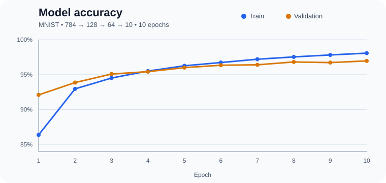
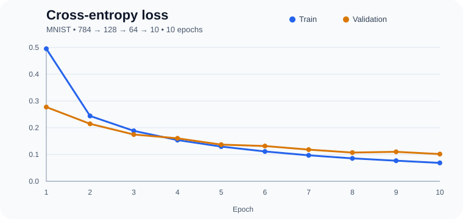
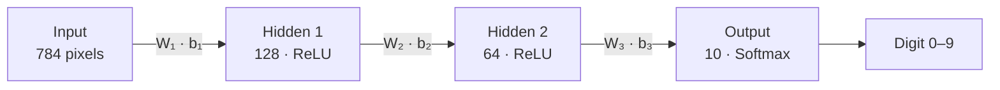

<div align="center">

# MLP MNIST · C from scratch

Многослойный персептрон для распознавания рукописных цифр.

**Чистый C · Без ML-фреймворков · Forward и backpropagation с нуля**

</div>

## Результаты

| Test accuracy | Test loss | Время обучения |
| :---: | :---: | :---: |
| **97.18%** | **0.0915** | **~9 мин 26 с** |

Результаты первого полного запуска на MNIST с архитектурой `784 → 128 → 64 → 10` и 10 эпохами обучения.

| Метрика | Train | Validation | Test |
| --- | ---: | ---: | ---: |
| Accuracy | 98.07% | 96.96% | **97.18%** |
| Cross-entropy | 0.0687 | 0.1017 | 0.0915 |

### Динамика обучения

<div align="center">
  
  
</div>

Метрики train накоплены во время обучения, validation рассчитана на фиксированной выборке после каждой эпохи. Test — официальная тестовая выборка MNIST, отдельная от обучения и валидации.

## Архитектура



- **Вход:** 28 × 28 пикселей, нормализованных в диапазон [0, 1].
- **Скрытые слои:** 128 и 64 нейрона с ReLU.
- **Выход:** 10 вероятностей классов, Softmax.
- **Параметры:** 109 386 обучаемых весов и смещений.
- **Инициализация:** He uniform для весов, нули для смещений.
- **Оптимизатор:** mini-batch gradient descent (SGD).

## Что реализовано

- Чтение бинарного формата IDX и проверка заголовков MNIST.
- Хранение матриц в непрерывных массивах памяти и матрично-векторное умножение.
- Прямой проход, ReLU, численно устойчивый Softmax и Cross-Entropy.
- Обратное распространение ошибки с вычислением градиентов всех весов и смещений.
- Накопление и усреднение градиентов по mini-batch, перемешивание индексов.
- Разделение Train/Validation и независимая оценка Test.
- Сохранение и загрузка параметров модели в текстовом файле.
- Автоматические тесты матричных операций, прямого прохода и численная проверка градиентов.

## Обучение

| Гиперпараметр | Значение |
| --- | ---: |
| Learning rate | 0.01 |
| Batch size | 16 |
| Epochs | 10 |
| Train | 50 000 |
| Validation | 10 000 |
| Test | 10 000 |

За одну эпоху выполняется 3125 обновлений параметров. Обучение использует только Train, валидация и тестирование выполняются без обновления весов.

### Backpropagation

Для каждого изображения в кэше сохраняются вход, активации скрытых слоёв и предсказания. Начальная дельта — разность вероятностей и one-hot-метки. Градиенты каждого полносвязного слоя вычисляются как внешнее произведение дельты и входных активаций; смещения получают ту же дельту. Все параметры обновляются после накопления градиентов полного батча.

Численная проверка сравнивает аналитические градиенты с центральной конечной разностью. На тестовой сети максимальное расхождение составило менее `1.5e-8`.

## Сборка и запуск

Требуется GCC с поддержкой C11. Команды выполняются из корня репозитория.

```bash
gcc -std=c11 -O2 src/main.c src/matrix.c src/mnist.c src/network.c src/train.c -o train.exe -lm
```

Запуск на Windows:

```cmd
train.exe
```

Программа читает данные из `data/`, обучает модель, печатает метрики каждой эпохи, затем вычисляет Test loss и accuracy. Обученные параметры сохраняются в `weights.csv`.

### Пример вывода

```text
Epoch 01/10 | Loss: 0.4952 | Acc: 86.37% | Val loss: 0.2773 | Val acc: 92.10% | Time: 57.73s
Epoch 05/10 | Loss: 0.1296 | Acc: 96.26% | Val loss: 0.1370 | Val acc: 96.00% | Time: 57.03s
Epoch 10/10 | Loss: 0.0687 | Acc: 98.07% | Val loss: 0.1017 | Val acc: 96.96% | Time: 56.37s
Test | Loss: 0.0915 | Accuracy: 97.18%
```

### Запуск тестов

```bash
gcc -std=c11 -Wall -Wextra -Wpedantic src/matrix.c tests/testMatrix.c -o testMatrix.exe
gcc -std=c11 -Wall -Wextra -Wpedantic src/matrix.c src/network.c tests/testNetwork.c -o testNetwork.exe -lm
```

```cmd
testMatrix.exe
testNetwork.exe
```

## Структура проекта

```text
mlp-mnist-project/
├── data/                  # Исходные IDX-файлы MNIST
├── include/               # Интерфейсы модулей
├── src/
│   ├── main.c             # Запуск обучения и тестирования
│   ├── matrix.c           # Матрицы и матрично-векторные операции
│   ├── mnist.c            # Загрузка и освобождение датасета
│   ├── network.c          # Forward, backpropagation и параметры
│   └── train.c            # Эпохи, батчи, метрики
├── tests/
│   ├── testMatrix.c
│   └── testNetwork.c
├── docs/                  # Графики реального запуска
└── README.md
```

## Датасет

[MNIST](https://github.com/cvdfoundation/mnist) — база рукописных цифр. В проекте используются исходные IDX-файлы с 60 000 обучающих и 10 000 тестовых изображений.

---

Учебный командный проект: собственная реализация математического ядра нейросети, работы с данными и обучения на C.
